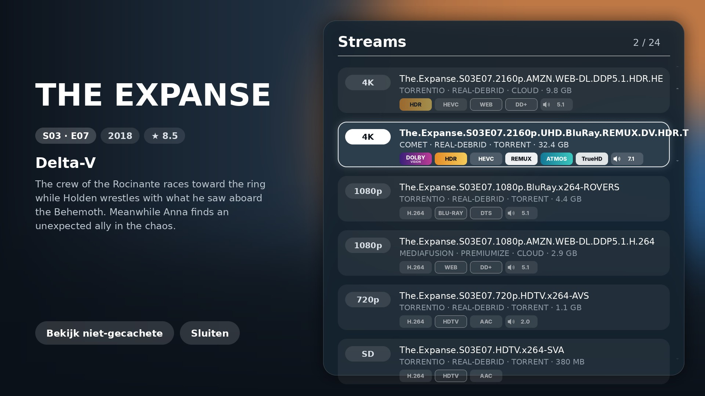
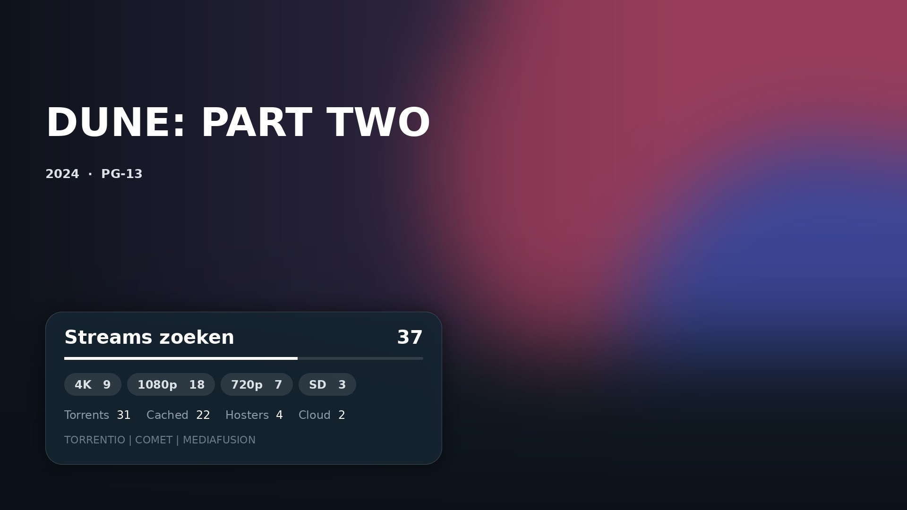
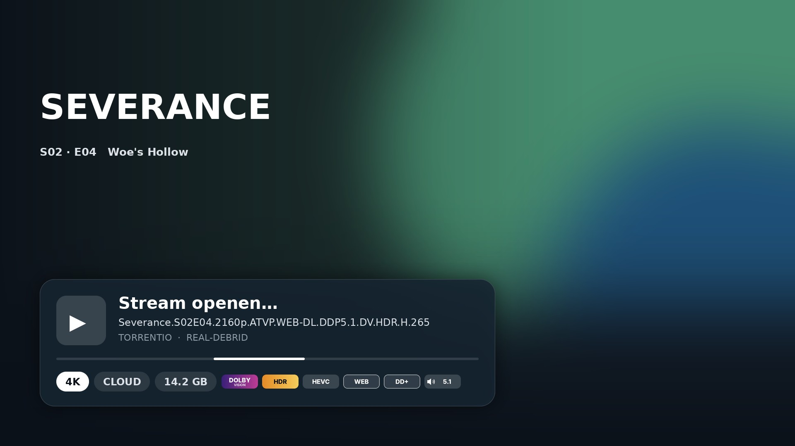
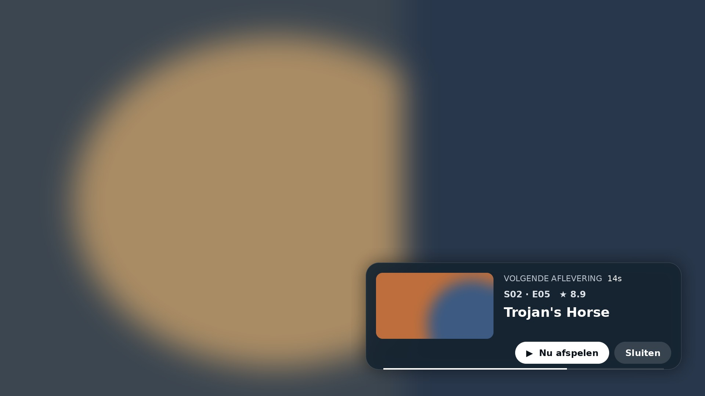
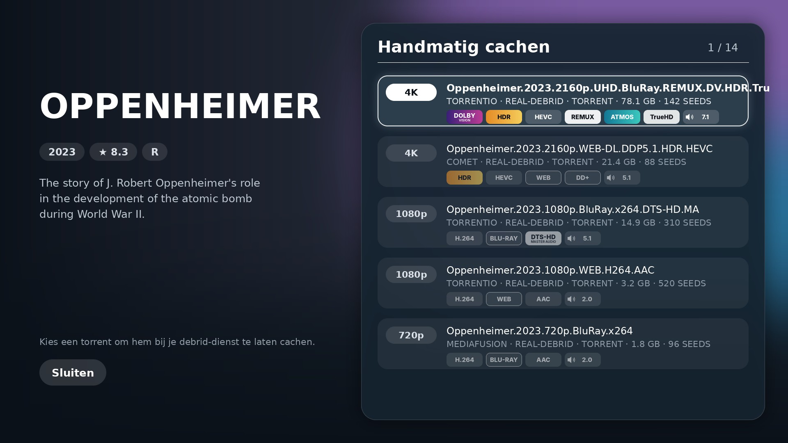
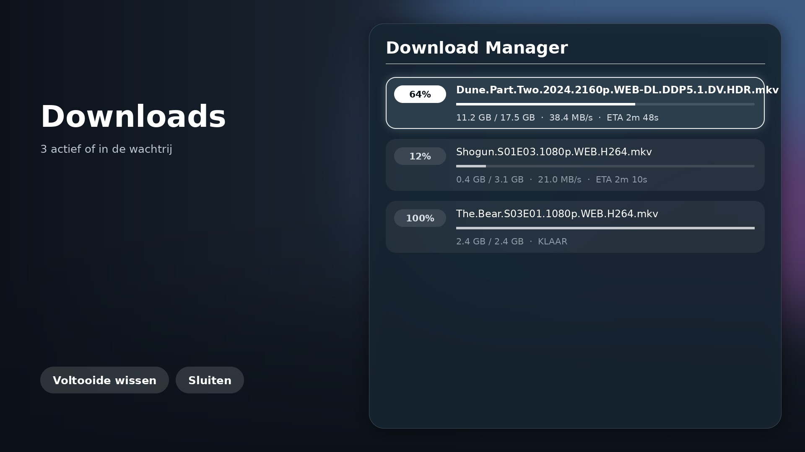

# Nuvio Arc V2 – theme for Seren

A dark, cinematic theme for the Kodi add-on **Seren**, styled after **Nuvio Arc V2** (Cinematic Glass): large backdrops, glass panels, rounded cards and a white glow on the selected button.



> The images are previews with placeholder artwork. In Kodi you will see the real backdrop and logo of the movie or show.

---

## What's included

| Screen | What you see |
| --- | --- |
| **Source select** | Logo, info and plot on the left; on the right a glass panel with all streams as cards, showing quality, provider, debrid, size and badges |
| **Scraping** | Progress bar and counts per quality (4K, 1080p, 720p, SD) and per source type |
| **Resolving** | Glass card with a loading bar and the badges of the chosen stream |
| **Playing next / Still watching?** | Glass card at the bottom right over the video, with a rounded thumbnail and a countdown bar |
| **Manual caching** | Same style as source select, including the number of seeds |
| **Download Manager** | One card per download with percentage, progress bar, speed and time remaining |
| **Background** | Backdrop and logo while loading |

### Badges instead of text

Instead of `DV | HDR | ATMOS`, the theme shows coloured badges, for example **Dolby Vision**, **HDR**, **HEVC**, **REMUX**, **Atmos**, **TrueHD**, **DTS:X** and **5.1 / 7.1**. There are 40 badges. Each stream only shows its own badges, neatly side by side without gaps. Low-quality releases (CAM, SCR, HC subs) are red.

The badges are original designs. They are not official Dolby or DTS logos.

---

## Screenshots

**Scraping**


**Resolving**


**Playing next**


**Manual caching**


**Download Manager**


---

## Installation

### Method 1: directly from GitHub (easiest)

1. Open Seren and go to **Tools → Open Settings Menu → Interface**.
2. Under Themes, choose **Install Theme → Web Location**.
3. Enter this address:
   ```
   https://github.com/djdirty60/Seren-Thema/releases/latest/download/seren.theme.nuvioarcv2.zip
   ```
4. Seren asks whether you want to use the theme. Choose **Yes**.

### Method 2: with a zip file

1. Download `seren.theme.nuvioarcv2.zip` from the [Releases page](https://github.com/djdirty60/Seren-Thema/releases).
2. Copy the file to your device, for example to the *Download* folder.
3. In Seren, go to **Tools → Open Settings Menu → Interface → Install Theme → Browse**.
4. Select the zip file, then choose **Yes**.

### Updates

From version 1.3.1 the theme updates itself through Seren. Seren checks for new versions automatically (setting **Interface → Automatically update themes**), or you can check by hand: **Tools → Open Settings Menu → Interface → Check For Updates**.

Coming from 1.3.0 or older? Install 1.3.1 once with one of the methods above. After that, updates arrive by themselves.

### Back to the default theme

Go to **Tools → Open Settings Menu → Interface → Switch Theme** and choose **Seren Default**.

---

## Good to know

- **Logos and backdrops** come from Seren itself (TMDB). Enter a free **Fanart.tv API key** in Seren to get more logos. If there is no logo, the title is shown in large letters instead.
- **Font**: the theme uses the fonts of your Kodi skin, so it may look slightly different from skin to skin.

### Works with these Kodi skins

The theme only uses the font names every skin has (or that Kodi falls back on), and keeps all its own images in a separate `nuvioarc/` folder, so they never clash with your skin's images. Tested against the font files of:

| Skin | | Skin | |
|---|---|---|---|
| Estuary (Kodi default) | ✅ | Arctic Fuse | ✅ |
| Nuvio Arc | ✅ | Arctic Fuse 2 | ✅ |
| Confluence | ✅ | Arctic Fuse 3 | ✅ |
| Arctic: Zephyr - Reloaded | ✅ | Bingie | ✅ |
| Aeon Nox: SiLVO | ✅ | FENtastic | ✅ |
| Eminence | ✅ | Mimic-LR | ✅ |
| Eminence 2 | ✅ | Amber | ✅ |
| Arctic Horizon | ✅ | Quartz | ✅ |
| Arctic Horizon 2 | ✅ | | |

In some skins the big titles are a bit smaller, because those skins have no large font with a standard name.
- **Not themed**: the filter, sort and provider settings windows. These keep the default Seren style.
- Made for Seren 3.x (Kodi 21 and 22), 1080p screen resolution.

---

## Folder structure

```
resources/
└── skins/
    ├── meta.json              theme name and version
    └── Default/
        ├── 1080i/             the windows (XML)
        └── media/nuvioarc/    textures
            └── flags/         the badges
screenshots/                   images for this README
```

Seren expects the `resources/` folder at the top level of the zip, so don't move it. The zip in the Releases is already built this way.

---

## Credits

- Inspired by the design of [Nuvio Arc](https://github.com/ysosrs123/NuvioTV-Fork). This theme is not affiliated with it.
- Made for [Seren](https://github.com/nixgates/plugin.video.seren) by Nixgates. This theme is not affiliated with Seren either.
