<p align="center">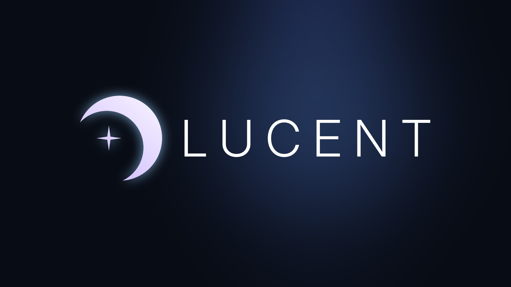</p>

# Lucent – theme for Seren

> Formerly called *Nuvio Arc V2*.

**Lucent** is a dark, cinematic theme for the Kodi add-on **Seren** in a glass style: large backdrops, glass panels, rounded cards and a white glow on the selected button.

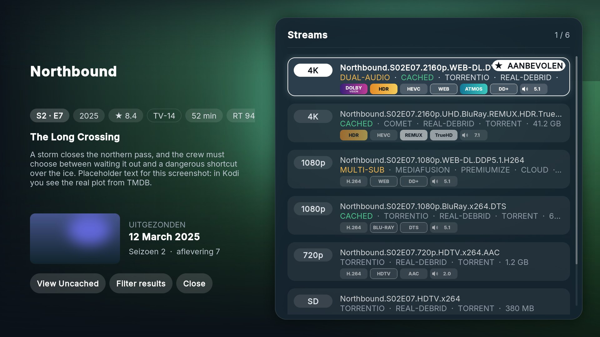

> Most images are screenshots of the theme running in a real Kodi, filled with placeholder titles and artwork. In Kodi you will see the real backdrop, logo and plot of the movie or show. The Resolving, Manual caching and Download Manager images are older previews.

---

## What's included

| Screen | What you see |
| --- | --- |
| **Source select** | Logo, info and plot on the left (with running time, Rotten Tomatoes and Metacritic when known, and for an episode its own picture and air date); on the right a glass panel with all streams as cards, showing quality, provider, debrid, size and badges, with CACHED (green) and language tags such as DUAL-AUDIO and MULTI-SUB in front of the provider. The first stream in Seren's own order is tagged **Recommended**. Includes Seren's *Filter results* button |
| **Scraping** | Progress bar, counts per quality (4K, 1080p, 720p, SD) and per source type, the best quality found so far with how many streams play straight away, and a chip for every provider that is still busy (they disappear as they finish). The backdrop slowly zooms in |
| **Resolving** | Glass card with a loading bar and the badges of the chosen stream |
| **Playing next / Still watching?** | Glass card at the bottom right over the video, with a rounded thumbnail, the short plot and running time of the next episode, and a countdown bar. Includes Seren's *Skip outro* (anime) and *don't continue* buttons |
| **Manual caching** | Same style as source select, including the number of seeds |
| **Download Manager** | One card per download with percentage, progress bar, speed and time remaining, plus pause, resume and cancel all |
| **Filters** | Five columns (video, HDR, audio, channels, other) with a switch per feature: on = hide those streams |
| **Sorting** | The sort rules as rows of pills: press a pill to change it, the arrow turns the order around |
| **Provider packages** | Your scraper packages as cards with icon, version and author; install a new package |
| **Provider settings** | The package's settings on the left, its providers as tiles with an on/off switch on the right, plus all on / all off |
| **Skip intro** | Seren's own *Skip intro / recap / outro / preview* button as a glass pill (Seren > Settings > Playback) |
| **Background** | Backdrop and logo while loading; the backdrop slowly zooms in |

### Badges instead of text

Instead of `DV | HDR | ATMOS`, the theme shows coloured badges, for example **Dolby Vision**, **HDR**, **HEVC**, **REMUX**, **Atmos**, **TrueHD**, **DTS:X** and **5.1 / 7.1**. There are 40 badges. Each stream only shows its own badges, neatly side by side without gaps. Low-quality releases (CAM, SCR, HC subs) are red.

The badges are original designs. They are not official Dolby or DTS logos.

---

## Screenshots

**Source select** – an episode with its own picture and air date; the first stream is tagged *Recommended*, with CACHED and language tags


**Scraping** – counts per quality, the best result so far and the providers that are still busy
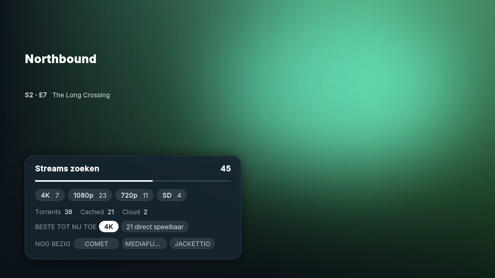

**Filters**
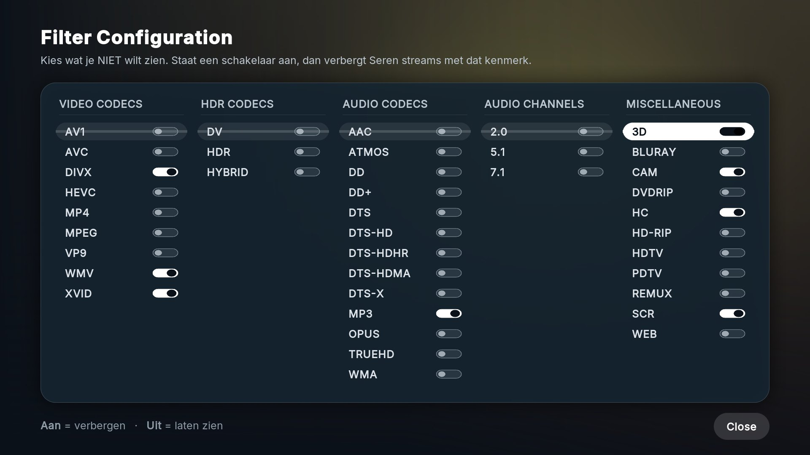

**Sorting**
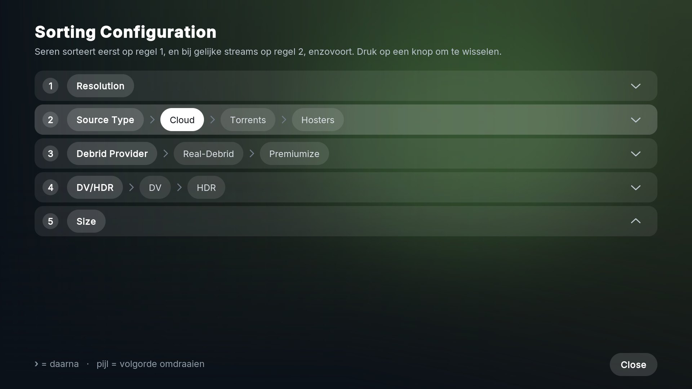

**Provider packages**
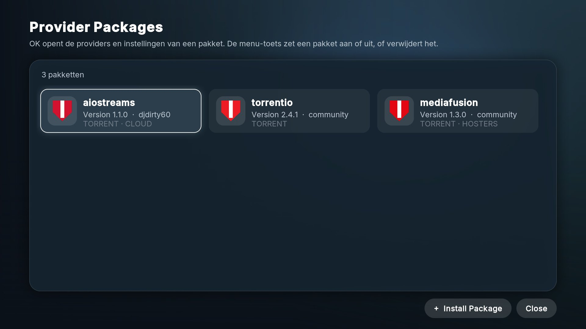

**Provider settings**
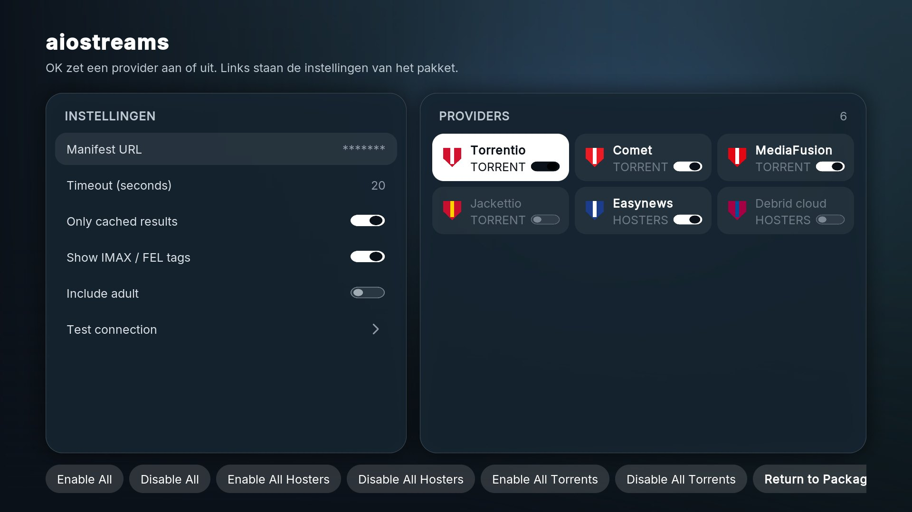

**Playing next** – with the plot and running time of the next episode
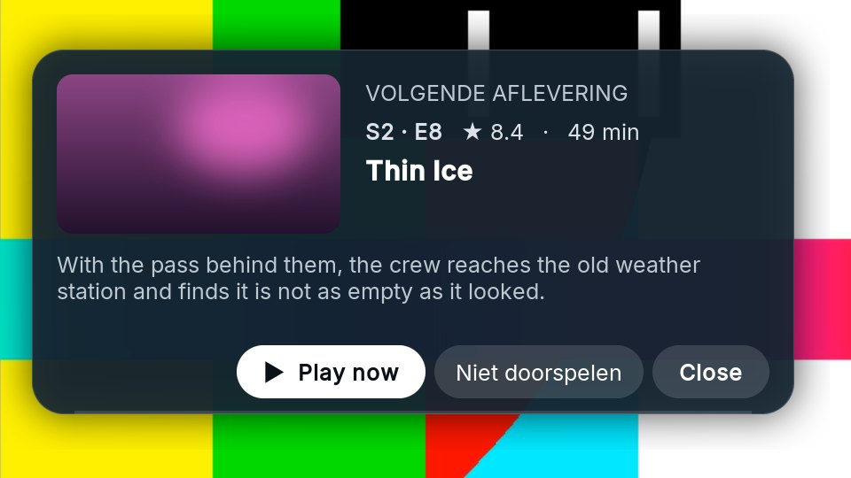

**Skip intro**
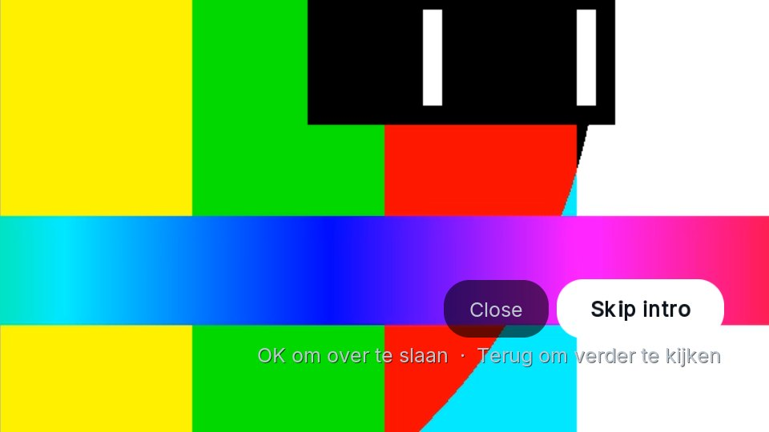

**Resolving**
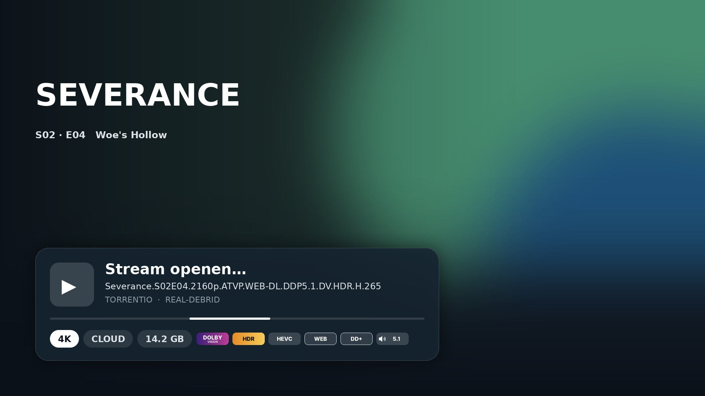

**Manual caching**
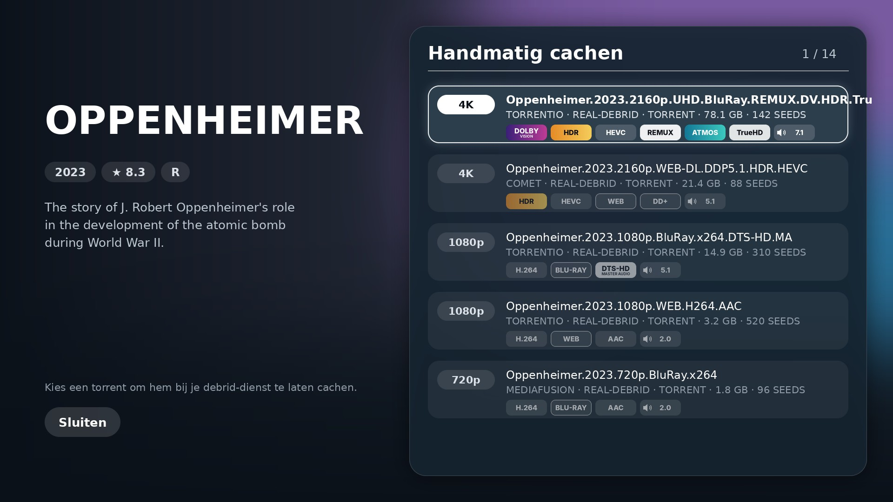

**Download Manager**
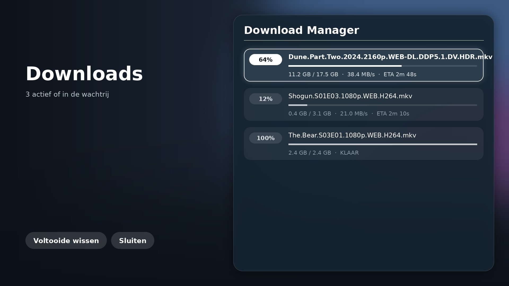

---

## Installation

### Method 1: directly from GitHub (easiest)

1. Open Seren and go to **Tools → Open Settings Menu → Interface**.
2. Under Themes, choose **Install Theme → Web Location**.
3. Enter this address:
   ```
   https://github.com/djdirty60/Seren-Thema/releases/latest/download/seren.theme.lucent.zip
   ```
4. Seren asks whether you want to use the theme. Choose **Yes**.

### Method 2: with a zip file

1. Download `seren.theme.lucent.zip` from the [Releases page](https://github.com/djdirty60/Seren-Thema/releases).
2. Copy the file to your device, for example to the *Download* folder.
3. In Seren, go to **Tools → Open Settings Menu → Interface → Install Theme → Browse**.
4. Select the zip file, then choose **Yes**.

### Updates

From version 1.3.2 the theme updates itself through Seren. Seren checks for new versions automatically (setting **Interface → Enable Automatic Theme Updates**), or you can check by hand: **Tools → Open Settings Menu → Interface → Check For Updates**.

Coming from 1.3.0 or older? Install the latest version once with one of the methods above. After that, updates arrive by themselves.

**Coming from Nuvio Arc V2 (1.3.x)?** The update to 1.4.0 installs the theme under its new name **Lucent**, next to the old one. Switch to it once: **Tools → Open Settings Menu → Interface → Switch Theme → Lucent**. Then remove the old one: **Uninstall Theme → Nuvio Arc V2**.

### Back to the default theme

Go to **Tools → Open Settings Menu → Interface → Switch Theme** and choose **Seren Default**.

---

## Good to know

- **Logos and backdrops** come from Seren itself (TMDB). Enter a free **Fanart.tv API key** in Seren to get more logos. If there is no logo, the title is shown in large letters instead.
- **Font**: the theme uses the fonts of your Kodi skin, so it may look slightly different from skin to skin.

### Works with these Kodi skins

The theme only uses the font names every skin has (or that Kodi falls back on), and keeps all its own images in a separate `lucent/` folder, so they never clash with your skin's images. Tested against the font files of:

| Skin | | Skin | |
|---|---|---|---|
| Estuary (Kodi default) | ✅ | Arctic Fuse | ✅ |
| Lucent (Nuvio Arc) | ✅ | Arctic Fuse 2 | ✅ |
| Confluence | ✅ | Arctic Fuse 3 | ✅ |
| Arctic: Zephyr - Reloaded | ✅ | Bingie | ✅ |
| Aeon Nox: SiLVO | ✅ | FENtastic | ✅ |
| Eminence | ✅ | Mimic-LR | ✅ |
| Eminence 2 | ✅ | Amber | ✅ |
| Arctic Horizon | ✅ | Quartz | ✅ |
| Arctic Horizon 2 | ✅ | | |

In some skins the big titles are a bit smaller, because those skins have no large font with a standard name.
- **Every Seren window** is themed (the calendars, QR login and language choice of some Seren builds excepted).
- **AIOStreams scraper**: with [seren-aiostreams-provider](https://github.com/djdirty60/seren-aiostreams-provider) the tags IMAX, FEL, NL and NL-SUBS appear in amber in front of the provider.
- Made for Seren 3.x (Kodi 21 and 22), 1080p screen resolution.

---

### Together with the Lucent skin

With the Lucent skin the theme follows it:

- **Colours**: the colour theme you pick in Lucent (Ocean, Rose, Gold, ...) also colours Seren's buttons, bars and focused cards. With any other skin the theme uses its own white glass look.
- **Light mode**: when Lucent runs in light mode (boxes with little memory), the theme leaves out the glow around cards and the slowly zooming backdrop.

## Folder structure

```
resources/
└── skins/
    ├── meta.json              theme name and version
    └── Default/
        ├── 1080i/             the windows (XML)
        └── media/lucent/    textures
            └── flags/         the badges
screenshots/                   images for this README
```

Seren expects the `resources/` folder at the top level of the zip, so don't move it. The zip in the Releases is already built this way.

---

## Credits

- Inspired by the design of [Nuvio Arc](https://github.com/ysosrs123/NuvioTV-Fork). This theme is not affiliated with it.
- Made for [Seren](https://github.com/nixgates/plugin.video.seren) by Nixgates. This theme is not affiliated with Seren either.
